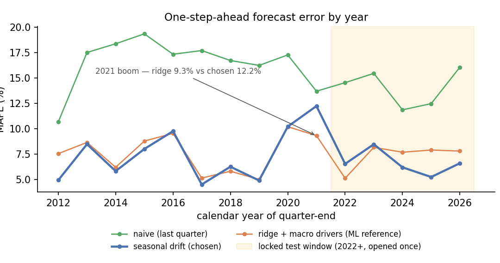
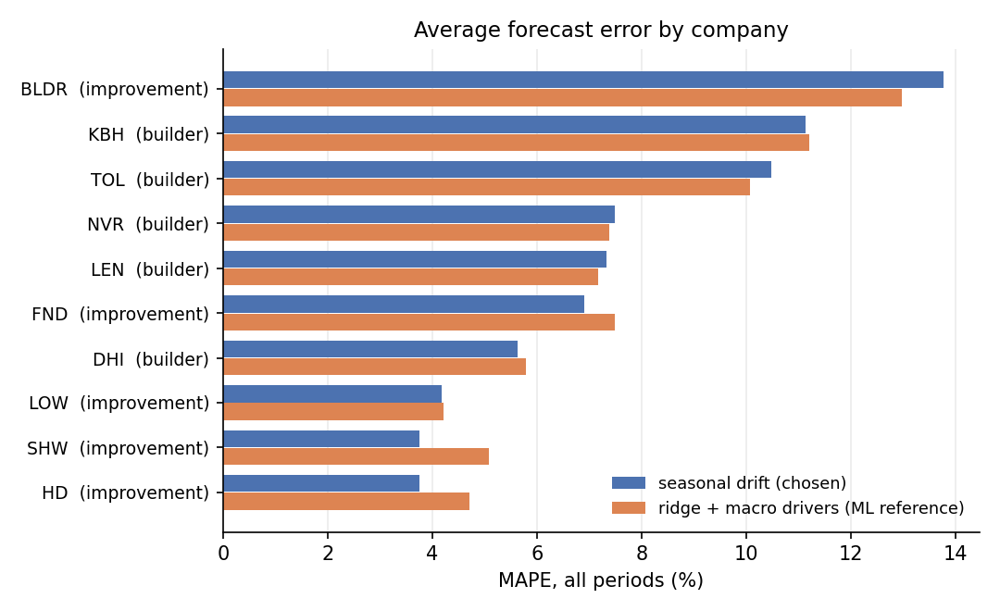
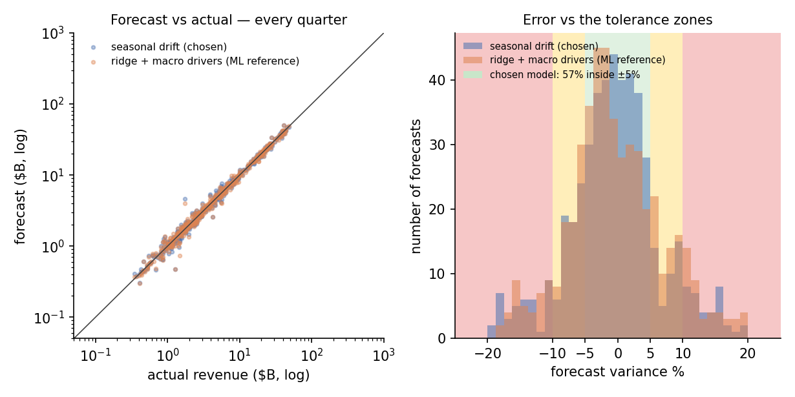

# Results Memo — Quarterly Revenue Forecasting for US Housing Stocks

**Scope:** 10 companies (5 homebuilders, 5 home-improvement), 2012–2026, 524
one-step-ahead forecast observations per model, ≈ **$4.1 trillion** of forecasted
revenue. Data: SEC EDGAR XBRL company facts + FRED macro drivers.

**Every number below is reproducible** (`python -m scripts.make_memo`) and traces to
the append-only run log in `runs/run_log.jsonl`. Test-window rows come from two
auditable sources only: the disclosed pre-split parquet, and the one-time frozen
test record opened 2026-10-22.

---

## The five findings

### 1. A machine-learning model could not beat "same quarter last year × recent growth" — and that is the correct, valuable answer

| Locked test window (2022+, 185 forecasts each, 19 quarters) | MAPE |
|---|---|
| ridge + mortgage-rate & housing-starts drivers (the pre-registered finalist) | 7.27% |
| seasonal drift baseline | **6.54%** |

Pre-registered decision rule (95% circular-block-bootstrap CI of the mean loss
difference entirely below zero) was **not met**; Diebold–Mariano p = 0.19.
The naive baseline beats naive expectations about ML: for one-step-ahead,
quarterly company revenue, own-history seasonality and momentum contain almost
all the information. Knowing *this* is what separates research from wishful
tuning — we did not shop the test set until something won.

### 2. But the ML model has a specific niche: regime breaks. 2021 is the proof

MAPE in the COVID boom year: **ridge 9.3% vs seasonal drift 12.2%** — a ~24%
error reduction. In a year when growth exploded beyond the company's own
recent trajectory, the macro features (housing starts, mortgage rates) added
real information. In "normal" rate cycles the baseline wins.

*All three models on one chart: **seasonal drift (chosen — thick blue)**, ridge + macro
drivers (orange, the ML reference), naive last-quarter (green). Shaded band = the
locked 2022+ test window; the 2020 spike is the COVID quarter, and 2021 is where
ridge actually wins (finding 2).*

### 3. In the rate-shock test years (2024–2026) the ridge model over-forecast badly — and the diagnosis is instructive

Mean forecast bias: ridge +7.0pp (2025) and +5.7pp (2026) vs the baseline's
+2.0pp/+0.5pp. The model learned "mortgage rates fall → growth accelerates"
from the 2008–2011 era, but the 2022+ cycle was different: builders raised
revenue through the rate shock (pricing + record backlogs). A macro
elasticity estimated on the last crisis did not transport — a textbook
illustration of why non-stationary macro relationships need regime-aware
handling, and why we kept the simpler model.

### 4. Forecastability is a *business* property, not a model property

All-period MAPE by company (both models within ~0.2pp of each other):

| Best (defensive / visible demand) | | Worst (cyclical) | |
|---|---|---|---|
| Home Depot | 3.8% | Toll Brothers | 10.5% |
| Sherwin-Williams | 3.8% | KB Home | 11.1% |
| Lowe's | 4.2% | Builders FirstSource | 13.8% |

Defensive, small-ticket, broad-customer revenue (HD/LOW/SHW) is ~3× easier to
forecast than backlog-to-book-and-burn builder revenue. For an
investor/planner this is actionable: error budgets and inventory buffers
should be set *per company by business model*, not per model.

*Paired horizontal bars per company, **coloured by model** (blue = chosen
seasonal drift, orange = ridge reference), sector in parentheses beside each
ticker; worst forecasters at the top. The two bars sit within ~0.2pp of each
other everywhere (finding 4): forecastability is a business-model property, so
the ranking — not the model gap — is the story.*

### 5. Honest uncertainty: empirically calibrated 80% intervals that actually covered 78.4% on the locked test

Prediction intervals built from each forecast's own-origin error quantiles
(per sector, expanding window) achieved 78.4% coverage vs 80% nominal —
binomial p = 0.58, i.e. statistically on target — with a pooled mean width of
~22%. Interval **honesty** (coverage) matters more than interval **narrowness**
when the output feeds decisions.

*Left: every one-step-ahead forecast vs its actual (log-log) — **both models**;
blue = chosen seasonal drift, orange = ridge reference; the diagonal is a perfect
forecast. Right: how far off each forecast was, binned into the same colour
zones the Variance sheet uses — green = within ±5% (on plan), amber = 5–10%
(review), red = beyond ±10% (escalate); 57.1% of chosen-model quarters land
inside ±5%; 76 of the 1,048 modeled forecasts fall beyond the displayed ±20%.
Positive variance = actual came in above the forecast.*

---

## Supporting data-quality finding

Restatement audit of every quarterly revenue figure: mean/median revision
between first and latest EDGAR filing ≈ **0.00%** (max 0.05%) — reporting
restatements are a non-issue in this sample, so late-filed corrections do not
contaminate the backtest. (Also: 6 XBRL tag aliases had to be merged per
company because filers switch revenue tags across years — a quiet data wrinkle
that breaks naive pipelines.)

## Business interpretation

- **What this is good for:** near-term (h=1 quarter) revenue nowcasts to
  triangulate guidance, prep for earnings, and set working-capital/inventory
  plans. At this horizon you *should* mostly trust own-history seasonality —
  and now it is documented, with a bounded error bar, per sector.
- **Where a model earns its keep:** quarters when the macro regime moves fast
  (2020/2021) — worth keeping a driver model as a *regime-switch* satellite,
  not as the everyday forecaster.
- **What we would try next:** extend the locked window (2027+) with a fresh
  pre-registered plan; horizon-h=2..4 forecasts; per-company shrinkage toward
  the pooled fit; and a regime-feature version (rate *direction × level*)
  fitted only on post-2015 data.

## Resume-ready bullets

- Built an end-to-end, leakage-controlled forecasting pipeline for 10 US
  housing equities (≈$4.1T forecasted revenue, 2012–2026) from raw SEC XBRL
  filings and FRED macro releases, with as-of publication-lag masking and
  rolling-origin evaluation.
- Pre-registered the model comparison (frozen plan + code/data fingerprints +
  one-time logged test-set opening) and adjudicated it with
  Diebold–Mariano and circular-block bootstrap inference at the quarter level;
  correctly concluded that a seasonal baseline ≥ ML model at h=1 (7.27% vs
  6.54% MAPE) rather than overfitting the holdout.
- Delivered empirically calibrated 80% prediction intervals (78.4% realized
  test coverage) and bias-corrected point forecasts from each forecast's own
  error history.
- Identified when ML adds value (boom-year growth breaks: −24% error) vs
  where it fails (transporting crisis-era rate elasticities into rate shocks:
  +7pp bias), and showed forecastability is a business-model property
  (3.8% defensive names vs 13.8% cyclical).

## Interview Q&A prep

- **"Why log YoY growth as the target?"** — stationarity, multiplicative
  seasonality, and percentage-scale errors; forecasts reconstruct as
  `rev(t-4) × exp(ĝ)`.
- **"Why pooled with a sector flag?"** — ~60 quarters per company is too few to
  fit anything nontrivial; pooling buys sample size while the sector flag
  (and optionally sector×driver interactions) carries heterogeneity.
- **"Why is the calendar quarter the inference unit?"** — same-quarter firms
  share shocks; treating 185 forecasts as independent would overstate power.
- **"Your model lost — so what's the takeaway?"** — discipline: the honest
  null (seasonality) is now the documented production rule, with calibrated
  intervals; the negative result is reproducible and cheap to maintain.
- **"How would you do it differently?"** — longer horizon, rolling α
  selection, per-company intercepts, regime features, and a bigger cross-section
  (more sectors) for power.